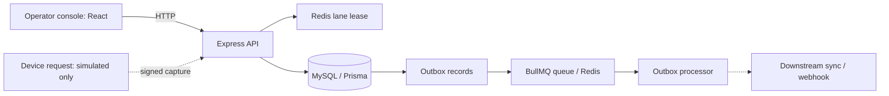
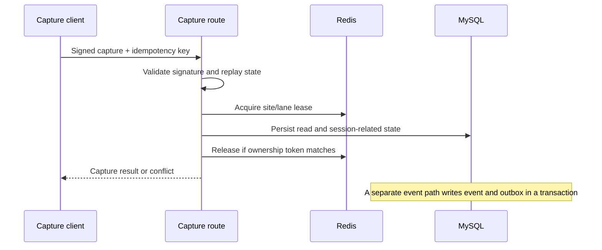

# Parkly architecture — source view

These diagrams describe inspected code at baseline `595934ac90a6108898a0e70027c6250ae583535e`. They are not a record of a running deployment. External devices, ALPR, downstream delivery, and the complete user journey have not been verified.

The sequence is deliberately simplified; it does not assert all writes share one transaction. See [capture routes](../../apps/api/src/modules/gate/interfaces/http/register-gate-capture-routes.ts), [read persistence](../../apps/api/src/modules/gate/infrastructure/gate-read-events.repo.ts), [lane lock](../../apps/api/src/lib/lane-lock.ts), and [event service](../../apps/api/src/services/event.service.ts).
